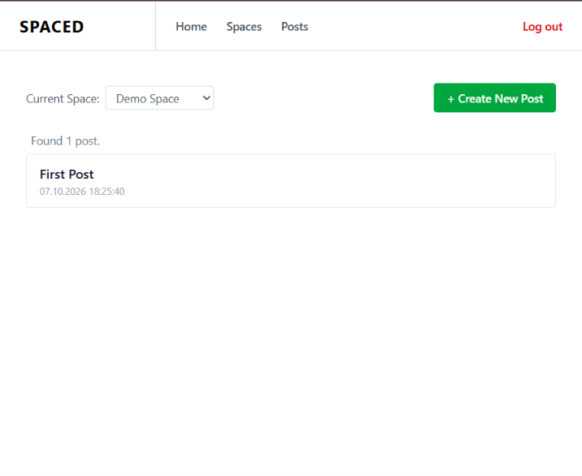

# spaced

To install dependencies:

```bash
bun install
```

To run:

At project root:
```bash
bun dev
```
This launches the development server.

cd /client and run:
```bash
cd client
bun dev
```
This launches the development server for the react client.

## Overview




### Server
Server code is located in the `src` directory.  
**src/lib**: utilities and shared code. e.g. error handling, prisma client instance  
**src/modules**: contains modules: e.g. user, space, auth  
The modules that implement the API logic contain a file named `service.ts`
This file implements the service layer for the module.  
It both contains 
the interface definitions and the implementation.
Similar separation has been made for repositories.
#### Controllers
Each module has a directory named `controller`.  
The dependency injection pattern is used to inject the service layer into the controller.
Each controller is function that takes dependencies as arguments and 
returns a `Handler` function. `Handler` is a type provided by `express`.
The router registers each controller in `router.ts`, and the controllers are subsequently connected to the express app object in `src/build-router.ts`. 
### Client
Client refers to the React client application, which uses the server API.  
See the documentation at [client/README.md](client/README.md)

This project was created using `bun init` in bun v1.4.0. [Bun](https://bun.com) is a fast all-in-one JavaScript runtime.
